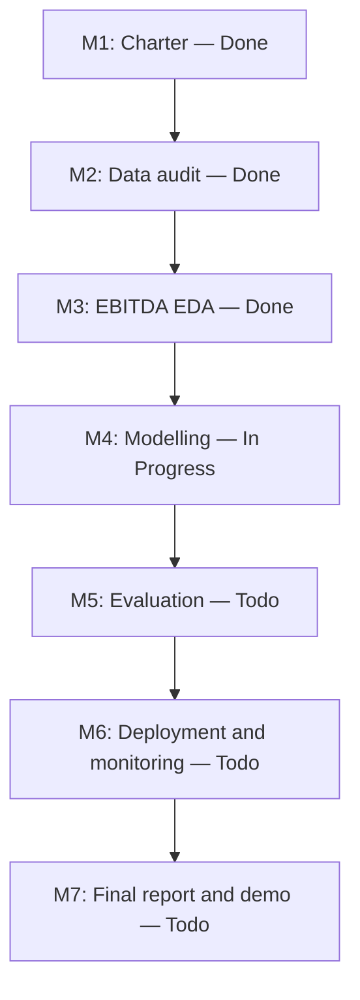

# GitHub Project Board and Delivery Workflow

**Project:** IndiGo Profitability Intelligence  
**Current active milestone:** M4 / D4 — Modelling and forecasting  
**Board columns:** Todo · In Progress · Done

> Important: GitHub Issue open/closed state is separate from the GitHub Projects Status field. The issue records below are corrected to reflect actual progress. Set the Project board Status field to the same column when adding/synchronizing cards; merely closing an issue does not automatically move its card from Todo.

## Done

| Work item | Record | Evidence |
|---|---|---|
| M1 / D1 — Project Charter | [Issue #1](../issues/1) | `milestones/M1_D1_Project_Charter/` |
| M2 / D2 — Dataset reconciliation and approval | [Issue #2](../issues/2) | `milestones/M2_D2_Data_Audit/` |
| M3 / D3 — EBITDA-margin EDA | [Issue #3](../issues/3) | `milestones/M3_D3_Exploratory_Data_Analysis/` |

## In Progress

| Work item | Record | Current focus |
|---|---|---|
| M4 / D4 — Modelling and forecasting | [Issue #4](../issues/4) | Build and compare forecasting models for next-quarter EBITDA margin; document validation, baseline comparison, results and limitations |

## Todo

| Work item | Record | Planned output |
|---|---|---|
| M5 / D5 — Model evaluation and robustness | [Issue #6](../issues/6) | Rolling-origin evaluation, leakage controls, error analysis and uncertainty |
| M6 / D6 — Deployment and monitoring | [Issue #5](../issues/5) | Integrate the approved M4/M5 model; validate API/UI, data health, prediction logging and monitoring |
| M7 / D7 — Final communication | [Issue #7](../issues/7) | Final report, model card, presentation, speaker notes and demo |

## Delivery sequence

## Board operating rules

1. The GitHub Projects Status field controls the visible Todo / In Progress / Done columns; issue open/closed state alone does not.
2. M1, M2 and M3 are complete. Keep their cards in Done and their issues closed.
3. M4 is the only active workstream now. Keep its card In Progress and its issue open.
4. M5, M6 and M7 have not started; keep them in Todo and their issues open.
5. Move a card to Done only when the deliverable is committed, reproducible and reviewed; close its issue at the same time.
6. Keep README, this workflow, `docs/PROJECT_STATUS_AND_WORKLOG.md`, `milestones/MILESTONE_REGISTER.csv`, issue status and board columns synchronized.
7. The current project target is EBITDA margin. Preserve the approved target and quarter definitions across modelling and evaluation.
