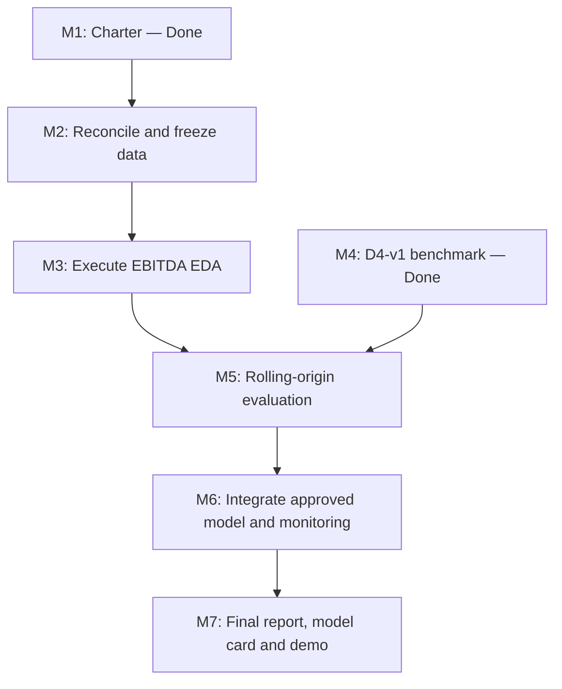

# GitHub Project Board and Delivery Workflow

**Project:** IndiGo Profitability Intelligence  
**Board columns:** Todo · In Progress · Done  
**Source of truth:** GitHub Issues linked below, milestone evidence folders, and the repository milestone register.

> The issue titles carry the board status prefix. Done items are closed; Todo and In Progress items remain open. If the GitHub Projects board is configured to auto-add repository issues, these records can be added to the matching columns. Otherwise add each linked issue to the board and set its Status field to the matching column.

## Done

| Work item | Record | Evidence |
|---|---|---|
| M1 / D1 — Project Charter | [Issue #1](../issues/1) | `milestones/M1_D1_Project_Charter/` |
| M4 / D4-v1 — Modelling checkpoint | [Issue #4](../issues/4) | `milestones/M4_D4_Modelling/` |

## In Progress

| Work item | Record | Next gate |
|---|---|---|
| M2 / D2 — Dataset reconciliation | [Issue #2](../issues/2) | Reconcile target/financial definitions, fiscal-quarter keys, availability dates and checksums; freeze approved master |
| M3 / D3 — EBITDA-margin EDA | [Issue #3](../issues/3) | Re-run on approved data and commit executed notebook with saved tables, charts and statistical outputs |
| M6 / D6 — Deployment and monitoring | [Issue #5](../issues/5) | Integrate D5-approved model; test API/UI, data health, prediction logging and monitoring |

## Todo

| Work item | Record | Planned output |
|---|---|---|
| M5 / D5 — Model evaluation | [Issue #6](../issues/6) | Rolling-origin backtest, point-in-time controls, error/regime analysis and uncertainty |
| M7 / D7 — Final communication | [Issue #7](../issues/7) | Final report, model card, presentation, speaker notes and demo |

## Delivery sequence

## Board operating rules

1. Every card must link to a GitHub Issue and a milestone evidence folder or a clearly named deliverable.
2. Move a card from Todo to In Progress only when work starts and an owner/next action is known.
3. Move a card to Done only when the deliverable is committed, reproducible and reviewed; close its issue at the same time.
4. Keep D4-v1 as a historical experiment. Do not imply its candidate ML models beat the persistence baseline.
5. Do not mark D5/D6/D7 complete before the corresponding evidence exists.
6. Keep README, `docs/PROJECT_STATUS_AND_WORKLOG.md`, `milestones/MILESTONE_REGISTER.csv`, issue status and board columns synchronized.
7. The currently approved project target is EBITDA margin. Reconcile older PAT references in legacy documents before reusing them as current project specifications.
