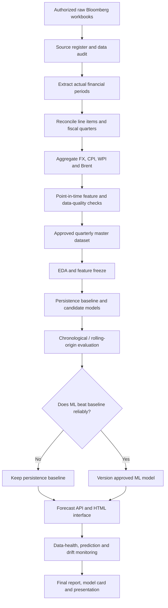

# Workflow and Data Governance — IndiGo Profitability Intelligence

**Version:** 1.0  
**Last reviewed:** 7 November 2026

## 1. End-to-end workflow

The model-development pipeline and the live refresh pipeline are separate. A current market refresh does not change historical model-training data or D4-v1. New observations become a new versioned dataset and are eligible for a new experiment only after validation.

## 2. Dataset inventory and responsibilities

| Dataset / file | Role | Current decision |
|---|---|---|
| `CP(6).xlsx` | Raw Bloomberg financial and indicator exports | Raw reference; byte-identical to `data/raw/CP(4).xlsx` already in GitHub |
| `CP Master Data(5).xlsx` | Master monthly/daily indicator series and legacy financial sheet | Raw/working reference; byte-identical to `data/raw/CP Master Data(3).xlsx` already in GitHub |
| `Final_Quarterly_Data(3).xlsx` | Current derived quarterly workbook with calculation audit and data-quality checks | Review candidate only; reconcile before approval |
| `EDA ANALYSIS(4).xlsx` | Flat quarterly EDA export | Not an authoritative target table; regenerate from approved master |
| `Final_Quarterly_Data(1).xlsx` | Exact D4-v1 experiment input | Immutable benchmark input; never overwrite |
| `notebooks/03_eda.ipynb` | EDA source notebook | Rerun locally after M2 sign-off |
| `milestones/M4_D4_Modelling/experiments/` | D4-v1 evidence | Preserve as immutable historical record |

### Current workbook hashes

| Workbook | SHA-256 |
|---|---|
| `CP(6).xlsx` | `208fc66a69c548023c4591bb8b7b5ba41624cdfe56fdd757612cc7b5fd01879e` |
| `CP Master Data(5).xlsx` | `30220588fe96276662a8eeadf56ea6a583da71479e0e26923383c517cc8af474` |
| `Final_Quarterly_Data(3).xlsx` | `87e56b4a08a81740c93386f62845bb48de53d0cbea754427b0da3d5b8fd5d970` |
| `EDA ANALYSIS(4).xlsx` | `0c2a79065faaee48cec6393f79ff330a98a9eb20c1add3e87e8a45dd7e1c0f46` |
| D4-v1 `Final_Quarterly_Data(1).xlsx` | `85bf9e7ee51860fa38892ba3cb3e24b74887645bb2570c096f6183e59a97670c` |

Do not infer that two files are identical from their names, sizes or row counts. Use SHA-256. A new raw workbook hash equal to a canonical raw file means it is the same binary content and does not need a duplicate upload.

## 3. Source register and variable definitions

| Category | Current source identifier | Available data | Limitation / validation |
|---|---|---|---|
| IndiGo financials | `INDIGO IN`; Bloomberg fields `SALES_REV_TURN`, `NET_INCOME`, `EBITDA` | Quarterly statement fields | Confirm exact Revenue from Operations and PAT mapping. EBITDA is not EBITDAR. Exclude estimates from realised targets |
| USD/INR | `USDINR REGN Curncy`; `PX_LAST` (and `PX_BID` in raw export) | Monthly exchange-rate observations | Verify observation and publication/availability date |
| CPI | `INFUTOTY Index`; `PX_LAST` | Monthly CPI inflation indicator | Confirm exact index definition, base and publication timing |
| WPI | `INBGWPIY Index`; `PX_LAST` | Monthly WPI inflation indicator | Confirm definition, base and publication timing |
| Oil benchmark | `EUCRBRDT Index`; `PX_LAST` | Daily and monthly Dated Brent crude | Proxy only; not Indian ATF or IndiGo realised fuel price |

There is currently no passenger volume, passenger load factor, revenue passenger kilometre (RPK) or available seat kilometre (ASK) dataset in the reviewed package. Do not add those variables to the model specification until an authorized, documented source is collected.

## 4. Canonical time and fiscal-quarter rules

Use Indian fiscal quarters consistently:
- Q1: April–June.
- Q2: July–September.
- Q3: October–December.
- Q4: January–March.

Use an explicit fiscal-year key such as `FY2018-Q1` for April–June 2017. Store the source period end date as a real date. Do not rely on quarter names without a year and fiscal convention.

Each observation should retain at least:
- `observation_date`: date represented by the value.
- `publication_date` or `available_at`: when the value became usable by a forecaster.
- `source_retrieved_at`: when the team obtained the value.
- `source_id` and `field_id`: exact Bloomberg security and field.
- `value`, `unit`, `frequency`, `status` and `quality_flag`.

A quarter-end date does not prove that the value was publicly available on that date.

## 5. Recommended approved master-dataset schema

Keep raw observations in their original frequency and create a separate modelling table. Recommended modelling columns:

| Column | Meaning |
|---|---|
| `fiscal_quarter` | Unique Indian fiscal-quarter key, e.g. FY2018-Q1 |
| `quarter_start`, `quarter_end` | Start and end of target quarter |
| `forecast_as_of_date` | Last calendar day before target quarter starts |
| `revenue_inr_mn` | Verified Revenue from Operations |
| `pat_inr_mn` | Verified PAT / agreed Net Income line item |
| `ebitda_inr_mn` | EBITDA, with definition and units documented |
| `pat_margin_pct` | PAT divided by Revenue from Operations × 100 |
| `ebitda_margin_pct` | EBITDA divided by the agreed revenue denominator × 100 |
| `usd_inr_q_mean` | Quarterly mean of eligible monthly USD/INR observations |
| `cpi_inflation_q_mean` | Quarterly summary of eligible monthly CPI observations |
| `wpi_inflation_q_mean` | Quarterly summary of eligible monthly WPI observations |
| `brent_daily_q_mean` | Quarterly mean of eligible daily Dated Brent observations |
| `brent_monthly_q_mean` | Quarterly mean of eligible monthly Dated Brent observations |
| `monthly_obs_count`, `daily_obs_count` | Number of source observations used in each aggregation |
| `financial_status` | Reported, Est, unavailable or other explicit source status |
| `financial_available_at` | Publication/availability date of financial outcome |
| `feature_availability_max` | Latest availability timestamp among the predictors |
| `source_version`, `source_hash` | Exact input workbook version/hash used |
| `quality_flag`, `exclusion_reason` | Audit results and reason for any exclusion |

This is a recommended schema. Do not populate unavailable source timestamps with invented dates. Leave unknown values missing and flag the limitation.

## 6. Point-in-time and leakage prevention

For each target quarter:
1. Set `forecast_as_of_date = quarter_start - 1 day`.
2. Only use predictor observations whose observation period is earlier than the target quarter.
3. Also require each predictor's actual publication/availability date to be on or before `forecast_as_of_date`.
4. Keep target-quarter EBITDA and Revenue from Operations as labels used to calculate EBITDA Margin; keep them out of predictors. PAT Margin may remain a separate reference outcome.
5. Do not use target-quarter or later financial results as features.
6. Fit imputation, scaling, feature selection and tuning only within the training portion of each chronological split.
7. Do not randomly shuffle quarterly observations.
8. Do not bridge missing financial quarters with artificial adjacent rows. A lag is valid only when the previous quarter is truly the immediately preceding reported quarter.

The D4-v1 one-quarter lag reduced direct same-quarter target leakage, but historical release timestamps are not available for all series. It therefore does not establish full point-in-time validity.

## 7. Quarterly aggregation and data-quality checks

### Aggregation
- Assign each monthly or daily observation to an Indian fiscal quarter using its observation date.
- Calculate means only after confirming frequency, units and date coverage.
- Record counts used for every quarterly mean.
- Define a completeness threshold before analysis. Do not label a partial quarter as complete.
- Keep original observation-level files unchanged.
- Do not forward-fill future observations or create a quarterly value from a month that was not yet available at the forecast cutoff.

### Quality checks
Run and save the results of:
- Missing and non-numeric values.
- Duplicate observation dates.
- Date range and invalid/future dates.
- Unit and scale consistency.
- Outlier and extreme-value review; do not automatically delete genuine shock periods.
- Actual-versus-estimate status.
- Raw-to-derived financial reconciliation.
- Fiscal-quarter mapping.
- Monthly/daily observation counts and completeness.
- Source publication/availability date eligibility.
- Formula and calculation audit.
- Target label missingness and supervised row accounting.

For the two unavailable early financial quarters in `Final_Quarterly_Data(3).xlsx`, set the margin targets to missing in any approved model table even though the workbook contains repeated numeric values in those cells.

## 8. EDA and modelling workflow

### EDA (M3)
1. Profile the approved data and its coverage.
2. Review distributions and extreme periods.
3. Analyse PAT and EBITDA margin trends.
4. Examine oil benchmark, USD/INR, CPI and WPI relationships with profitability.
5. Test quarter/seasonal differences using the fiscal-quarter key.
6. Record sample sizes and effect sizes with statistical tests.
7. Record insights with confidence/limitations.
8. Freeze only the predictor definitions that pass the point-in-time checks.

EDA relationships are descriptive/associational; do not describe them as causal or as proof of forecast accuracy.

### Modelling and evaluation (M4/M5)
1. Establish persistence or another simple, justified baseline.
2. Compare parsimonious challengers such as Ridge/Elastic Net; add tree models only if sample size permits.
3. Use chronological fixed splits for a locked holdout and expanding-window/rolling-origin backtests for robustness.
4. Compare models on the same eligible quarters.
5. Report MAE and RMSE in EBITDA-Margin percentage points; add directional measures only if precisely defined.
6. Inspect errors by regime and exceptional period.
7. Quantify uncertainty where sample size supports it; define when a forecast should be withheld.
8. Select the model based on repeatable out-of-sample evidence, stability and usefulness.
9. If ML does not beat persistence, keep persistence as the selected rule and document the outcome honestly.

D4-v1 remains an immutable historical benchmark. It used 35 supervised examples (21 train, 6 validation, 8 test); persistence validation MAE/RMSE were 12.18/13.92 pp and locked-test MAE/RMSE were 11.53/14.20 pp. Ridge and Random Forest did not beat validation persistence.

## 9. Deployment and monitoring workflow (M6)

Existing code provides a FastAPI backend, HTML/CSS/JavaScript frontend and four independent market-data connectors (USD/INR, Brent, CPI and WPI), plus refresh/store functionality. These are prototype components, not evidence of completed production deployment.

Before showing a forecast:
- Verify that every required input exists and is fresh.
- Display data source and timestamp.
- Use exactly the same feature order, transformations and units as the evaluated model.
- Store the model/version, input dataset version/hash, forecast as-of date, feature values, forecast result and later actual outcome.
- Withhold a forecast where critical inputs are stale, missing, outside valid bounds or not point-in-time eligible.

Monitor source/API failures, data freshness, missingness, unexpected value ranges, feature drift, forecast errors after actual publication, model version and retraining triggers. Keep credentials in environment variables or a secret manager; never expose keys in frontend code or public commits. Verify provider quotas, schemas and data-use/display rights before public deployment.

## 10. Repository structure and where to save evidence

| Location | Use |
|---|---|
| `data/raw/` | Authorized immutable raw source files, only when redistribution is permitted |
| `data/processed/` | Approved derived datasets, each with a version and manifest |
| `data/source_register.csv` | Source, security, field, units, frequency and access conditions |
| `data/collection_tracker.csv` | Collection progress and source-date coverage |
| `docs/` | Project plan, dataset schema, audit reports, workflow and project status |
| `notebooks/` | Reproducible analysis notebooks |
| `src/` | Data preparation, feature engineering, connectors and modelling code |
| `experiments/` | Versioned experiment logs, metrics, predictions and environment manifests |
| `models/` | Only selected, versioned model artifacts; do not store unselected candidate models as approved |
| `backend/` and `frontend/` | API service and user interface |
| `milestones/M1_D1_Project_Charter/` through `M7_D7_Final_Communication/` | Course deliverables, evaluation records and milestone manifests |
| `reports/` | Reviewed reports; avoid publishing output-rich Bloomberg-derived material without permission |

## 11. Versioning and audit rules

1. Never overwrite raw workbooks.
2. Never overwrite `Final_Quarterly_Data(1).xlsx` or D4-v1 experiment evidence.
3. Use versioned names for new derived datasets, such as `Final_Quarterly_Data_v2_YYYYMMDD.xlsx`; avoid ambiguous names such as `final_latest_new.xlsx`.
4. Compute SHA-256 for every input workbook and final dataset.
5. Maintain a data manifest with filename, hash, sheet names, row counts, date coverage, units, source IDs, exclusions and change summary.
6. Record every cleaning or calculation decision in the Calculation Audit and a concise change log.
7. Keep experimental outputs separate from approved outputs.
8. If a new dataset changes the row set, target series, fiscal labels or feature values, it requires a new experiment version and new metrics.
9. Do not claim uploaded unless the exact file exists in GitHub and the commit/path is verified.
10. Do not publish Bloomberg raw values or derived outputs unless the current licence explicitly permits it. Earlier package permission does not automatically cover later files or rendered reports.

## 12. Release gates

| Gate | Required evidence | Approval condition |
|---|---|---|
| M2 data freeze | New master, source mapping, quality checks, calculation audit, manifest/hash | Financial line items and fiscal-quarter mapping reconciled; actual/estimate and availability status explicit |
| M3 EDA freeze | Re-run notebook, figures/tables, hypotheses and insight log | EDA uses only approved master; features and sample size documented |
| M4/M5 model freeze | Baseline/challenger runs, rolling-origin results, error analysis, uncertainty and model card | No leakage; same-fold baseline comparison; model selected on out-of-sample evidence |
| M6 prototype acceptance | API/frontend tests, data-health tests, security checks and demo runbook | Live feature pipeline matches evaluated model and withholds invalid forecasts |
| M7 final submission | Report, model card, slides, notes, demo and references | All claims trace to repository evidence and limitations are disclosed |

## Adopted target scope — 8 November 2026

The primary forecast label for the active project is `target_ebitda_margin_pct`, calculated as target-quarter EBITDA divided by Revenue from Operations × 100. Target-quarter EBITDA and Revenue are label inputs only and must never enter the predictor matrix. PAT fields can be retained for reconciliation or secondary reporting but are not the current model target. The submitted D1 PDF's original PAT proposal is superseded for downstream project work by the scope decision recorded in M1.

**Legacy implementation warning:** the existing `src/build_master_dataset.py` and `src/d4_train.py` currently encode PAT-target fields/logic. Until updated and tested for EBITDA Margin, they are legacy PAT-specific implementations and must not be described as the active EBITDA pipeline.
